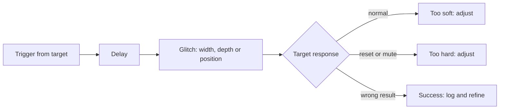

# Glitching Methods and Equipment Classes

Every fault injection method pushes a circuit outside its operating envelope for a short time: too little voltage, too short a clock cycle, too strong a local field, or photons where none should be. This chapter describes the main methods, the classes of equipment used in teaching and research labs, and the parameter search that turns a random disturbance into a repeatable fault. It stays at lab-education level: the goal is to understand and test your own designs.

Timmers and Spruyt (Black Hat Europe 2016), following Bar-El et al.'s "Sorcerer's Apprentice Guide to Fault Attacks" (2004), list four external techniques: clock, voltage, electromagnetic and laser. Their remark that all of them introduce faults *externally* is worth keeping in mind; the CLKSCREW work later showed an internal, software-driven variant.

## Methods compared

| Method | Mechanism | Precision | Invasiveness | Typical lab cost |
|---|---|---|---|---|
| Clock glitching | Insert a short cycle or extra edge in an external clock | Cycle-level timing, chip-wide | Low (needs external clock input) | Low |
| Voltage (crowbar) glitching | Briefly short or pull down the core supply | Timing good, spatially global | Low to medium (decoupling capacitors often removed) | Low |
| Shaped voltage glitching | Drive the supply with an arbitrary waveform | Better control of fault type | Medium | Low to medium |
| Electromagnetic fault injection (EMFI) | High-voltage pulse through a small coil over the die | Spatially local, timing good | Low (often no decapping needed) | Medium |
| Laser / optical | Focused light induces photocurrents in transistors | Very high spatial and temporal precision | High (decapping, often backside) | High |
| Body biasing, temperature | Shift operating point | Coarse | Low to medium | Low |
| Software-controlled DVFS (CLKSCREW) | Abuse on-chip frequency/voltage regulators from privileged software | Timing good | None (remote, privileged) | None |

### Clock glitching

Synchronous logic must settle between clock edges. A shortened cycle makes the next stage latch an unsettled value. Clock glitching needs the target to run from an external clock the attacker controls; many modern MCUs run from internal oscillators or include clock monitoring. Datko, Quartier and Belyayev's "Breaking Bitcoin Hardware Wallets" (DEF CON 25, 2017) reported that the wallets they studied had not enabled the STM32's Clock Security System, leaving clock faults possible; enabling clock monitoring is therefore one of the cheapest hardening steps.

### Voltage glitching

Pulling the core voltage down for nanoseconds to microseconds slows logic and causes timing violations. Timmers and Spruyt summarise the craft: pull the voltage down at the right moment, "not too soft, not too hard". A crowbar circuit (a fast MOSFET shorting the rail) is the classic approach. Bozzato, Focardi and Palmarini's "Shaping the Glitch: Optimizing Voltage Fault Injection Attacks" (IACR TCHES 2019) produced arbitrary glitch waveforms with inexpensive equipment and reported firmware extraction on six microcontrollers from STMicroelectronics, Texas Instruments and Renesas, with responsible disclosure to the manufacturers. Some of their harder attacks needed more than a million glitches, a reminder that automation and patience matter more than single shots.

### Electromagnetic fault injection

A pulse of hundreds of volts through a small probe coil creates a short, intense magnetic field that induces currents in the chip's metal layers. EMFI is local: probe position selects which part of the die is disturbed. Abdellatif, Hériveaux and Thillard (Black Hat USA 2022) describe EMFI as a high-voltage pulse injected into a probe, producing localised faults, with decapping "not important (it depends)". Their ESP32-V3 work used an XYZ stage to scan probe positions.

### Laser fault injection

Focused laser pulses ionise silicon and can flip individual SRAM cells or disturb specific gates. Laser attacks normally require removing the package, often from the back, and expensive optics. Anderson's *Security Engineering* (2008) mentions rear-side optical attacks for both fault induction and memory readout. Laser work is the domain of professional evaluation labs; it is described here so designers understand why certified secure elements include light sensors and active shields.

### Software-induced faults

CLKSCREW (Tang, Sethumadhavan and Stolfo, 2017) characterised the voltage and frequency regulator limits of a Nexus 6 phone, confined the fault to one core, and timed over-clocking so it hit TrustZone code. No external equipment was involved. Countermeasures include hardware limits on regulator settings that software cannot override and isolating security-critical cores from shared power domains.

## Equipment classes for teaching labs

- **Open-source glitch and capture boards (ChipWhisperer-class).** NewAE's ChipWhisperer family combines clock and crowbar voltage glitching with power capture, Python control, and training targets. Timmers and Spruyt pointed audiences to a ChipWhisperer-Lite demonstration. These are the standard starting point for courses.
- **FPGA-based glitchers.** Custom FPGA designs give nanosecond timing and flexible triggers.
- **EMFI tools.** Commercial and open designs (for example NewAE's ChipSHOUTER class) with probe tips and XYZ stages.
- **Laser stations.** Professional equipment with microscopes and positioning; rarely in teaching labs.
- **Supporting gear.** Oscilloscope, programmable power supply, logic analyser, serial adapter, a trigger signal from the target or from a GPIO.

## The parameter search

A glitch has parameters: delay after trigger, width, depth (voltage) or offset (clock), repetition, and for EMFI the position and pulse voltage. Timmers and Spruyt's method is a good template:

1. **Characterise on code you control.** Run a loop that increments a counter many times and reports the result over UART.
2. **Classify responses.** *Expected* (glitch too soft), *mute/reset* (too hard), or *success* (wrong counter value).
3. **Randomise** delay, voltage and length within the attack window and log every attempt.
4. **Narrow** to regions with high success rates, then move to the real target code.

## Worked example

> **Execution status:** Not executed in this book's CI; verify locally with a ChipWhisperer-class kit and its own training target (for example a ChipWhisperer-Lite with an STM32F3 or XMEGA target board). Do not adapt this to commercial products you do not own.

1. Install the ChipWhisperer software and open the vendor's clock-glitching tutorial notebook for your target.
2. Build and flash the tutorial firmware, which runs a nested loop and prints counters, exactly as the notebook describes.
3. Configure the glitch module as the notebook instructs (clock source, glitch width and offset ranges, trigger).
4. Run a sweep over width and offset, logging each outcome as normal, reset or glitched.
5. Plot outcomes as a heat map (width on one axis, offset on the other) with matplotlib.
6. Repeat with the voltage (crowbar) glitch tutorial and compare which parameter regions produce faults without resets.
7. Write down the success rate in the best region. This number is your baseline for testing countermeasures in Chapter 5.

## Common pitfalls

- **No reliable trigger.** Without a stable timing reference, results look random.
- **Decoupling capacitors left in place.** They absorb voltage glitches; removing them on your own lab board is part of setup.
- **Logging only successes.** Reset and normal outcomes define the boundaries you need.
- **Damaging targets.** Start soft and widen gradually; keep spare targets.
- **Skipping safety.** EMFI and laser equipment can injure people.

## Exercises

1. Reproduce the heat map from the worked example and identify the best region for faults without resets.
2. Enable the training target's clock monitoring (if supported) and repeat the clock sweep; record the change.
3. Compare clock and voltage glitching on the same target in a table of success rate, reset rate and setup effort.

## Further reading

- Timmers and Spruyt, "Bypassing Secure Boot using Fault Injection", Black Hat Europe 2016
- Bozzato, Focardi and Palmarini, "Shaping the Glitch: Optimizing Voltage Fault Injection Attacks", IACR TCHES 2019(2): <https://tches.iacr.org/index.php/TCHES/article/view/7390>
- Tang, Sethumadhavan and Stolfo, "CLKSCREW", USENIX Security 2017 / Black Hat Europe 2017 white paper
- Abdellatif, Hériveaux and Thillard, "Unlimited Results: Breaking Firmware Encryption of ESP32-V3", Black Hat USA 2022
- ChipWhisperer documentation: <https://chipwhisperer.readthedocs.io/>
