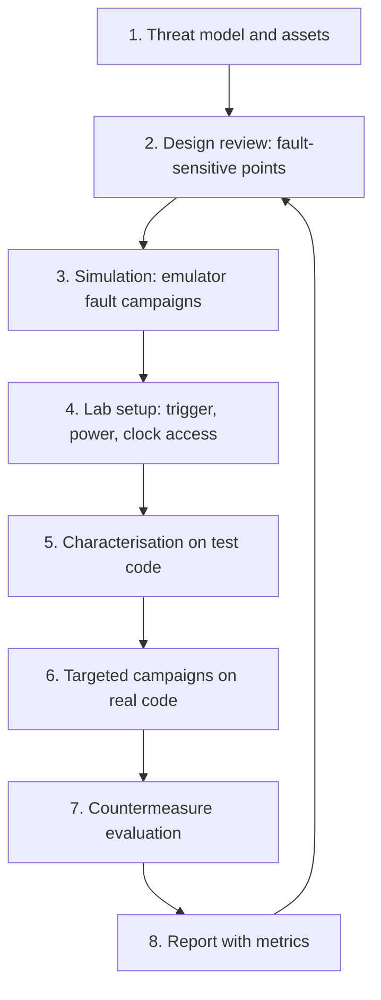

# Testing Methodology and Review Checklist

Fault injection testing is part engineering, part statistics. A single successful glitch proves a vulnerability exists; a thousand failed glitches prove almost nothing. This chapter describes a methodology for testing your own embedded designs, a design-review checklist that can be applied before hardware exists, and guidance on reporting. It assumes the lab skills from Chapters 2 and 4 and the countermeasures from Chapter 5.

## Rules before you start

- **Authorisation.** Test only devices you own or have written permission to test. For products, agree scope, sample counts and destructive testing in advance.
- **Safety.** EMFI injectors and laser stations involve high voltage and optical hazards. Follow manufacturer instructions, use interlocks and eye protection, and do not work alone with high-voltage equipment.
- **Disclosure.** Report findings in third-party products to the vendor, allow time to fix, and coordinate publication. Many of the published works cited in this book followed responsible disclosure; Bozzato, Focardi and Palmarini (TCHES 2019) explicitly reported to manufacturers first.
- **Samples.** Expect to damage targets. Budget spares.

## Methodology

**1. Threat model.** Which attacker class (Chapter 1) is in scope? An opportunistic attacker with a cheap glitcher and minutes of access implies different tests from a professional lab with laser equipment.

**2. Design review.** List every security decision and secret-dependent computation: signature and hash checks, protection-bit reads, PIN counters, key derivation, crypto operations whose faulty output would be released. Use the checklist below.

**3. Simulation.** Before hardware, run instruction-skip and bit-flip campaigns in an emulator (the Chapter 1 Unicorn approach) or with compiler-level fault simulation. This is cheap, finds most single-point failures, and gives a baseline to compare with hardware results.

**4. Lab setup.** Get a reliable trigger (a GPIO toggle in test builds, or a recognisable power or communication event in production builds), access to the core supply or clock, and a way to observe outcomes (UART, debug pins, power trace).

**5. Characterisation.** Use a known loop on the target (Chapter 2) to find parameter regions that produce faults without resets. Re-characterise when temperature, supply or board changes.

**6. Targeted campaigns.** Move to the real code. Sweep the delay across the window around each sensitive operation identified in step 2. Log every attempt with parameters and outcome class.

**7. Countermeasure evaluation.** Repeat the same campaigns against hardened builds and with sensors enabled. Compare metrics (Chapter 5).

**8. Report.** Include parameters, attempt counts, success and detection rates, time to first success, and equipment class, so others can judge effort and reproduce results.

## Statistics

A useful rule of thumb for zero-success campaigns: if you observe 0 successes in *N* independent attempts, the "rule of three" gives an approximate 95% upper bound on the per-attempt success probability of 3/*N*. After 100,000 attempts with no success you can say the rate in that parameter region is probably below 3 in 100,000, which is a statement about that region and setup, not a proof of immunity. Bozzato et al. reported attacks needing more than a million glitches; size campaigns accordingly.

## Design review checklist

### Fault-sensitive decisions

| # | Check |
|---|---|
| D1 | Every security decision uses large-Hamming-distance constants, not 0/1 booleans |
| D2 | Every security decision is checked at least twice in a way that survives compilation (verified in disassembly) |
| D3 | Result variables default to failure |
| D4 | Control-flow counters verify that all steps ran |
| D5 | Failure paths reset and count; no infinite loops |
| D6 | Repeated failures wipe keys or lock the device using monotonic, protected counters |
| D7 | Trap and exception vectors initialised before anything else at boot |

### Cryptography

| # | Check |
|---|---|
| C1 | RSA-CRT signatures verified before release, with the verification itself hardened |
| C2 | ECC input, intermediate and output points validated on the curve |
| C3 | Ladder coherence or equivalent integrity check on scalar multiplication |
| C4 | Deterministic signature schemes include protection against fault-induced nonce reuse |
| C5 | Symmetric crypto protected by redundancy or infective computation where faults are in scope |
| C6 | Hardware crypto engines' fault-detection features enabled and tested |

### Platform

| # | Check |
|---|---|
| P1 | Voltage, clock, temperature (and for SEs, light) sensors enabled and calibrated per part |
| P2 | Clock monitoring enabled; internal oscillator used for security-critical phases |
| P3 | Protection and secure-boot configuration bits read redundantly |
| P4 | Debug interfaces disabled or authenticated in production |
| P5 | Untrusted software cannot set voltage or frequency for secure code |
| P6 | Keys bound to measured boot state where possible |

### Process

| # | Check |
|---|---|
| R1 | Emulator fault campaigns run in CI on security-critical functions |
| R2 | Hardware campaigns repeated for each silicon revision and major firmware change |
| R3 | Results reported with metrics and equipment class |
| R4 | External evaluation for high-assurance products |
| R5 | Disclosure policy published and followed |

## Severity guidance

| Finding | Suggested severity |
|---|---|
| Single fault bypasses secure boot or readout protection | Critical for high-assurance products |
| Single fault leaks a private key (for example unverified RSA-CRT) | Critical |
| Attack requires many correlated faults and lab-grade equipment | Medium to high, depending on asset value and attacker class |
| Detector false positives in normal operating range | Medium (availability) |
| Countermeasure removed by compiler | High (protection silently absent) |

## Worked example

> **Execution status:** Not executed in this book's CI; verify locally on your own lab target and code.

Run a complete mini-assessment of the lab bootloader from Chapters 4 and 5.

1. Write a one-paragraph threat model: opportunistic attacker, voltage and clock glitching, one hour of access.
2. Apply the design-review checklist to the bootloader source and record each item as pass, fail or not applicable.
3. Run the emulator single-skip campaign on the verification function and record vulnerable instructions.
4. Characterise the target with the counter loop and record the best parameter region.
5. Run 10,000 glitch attempts on the plain bootloader and 10,000 on the hardened one, logging outcome classes to CSV.
6. Compute success rates and, for any zero-success campaign, the 3/*N* upper bound.
7. Write a two-page report with the checklist, metrics table and recommendations.

## Common pitfalls

- **Declaring "secure" after a short campaign.** Report bounds and conditions, not absolutes.
- **Testing debug builds only.** Production compiler flags change what survives.
- **Changing several variables at once.** Board, temperature and parameters all affect results.
- **Skipping simulation.** Emulator campaigns are cheap and catch most single points of failure.
- **Publishing without disclosure.** Coordinate with affected vendors.

## Exercises

1. Run the worked example end to end and produce the report.
2. Add an emulator fault campaign to a CI pipeline for one security-critical function and make the build fail if single-skip vulnerabilities appear.
3. Apply the checklist to an open-source bootloader (reading code only) and list the items that would need hardware testing to confirm.

## Further reading

- Timmers and Spruyt, "Bypassing Secure Boot using Fault Injection", Black Hat Europe 2016
- Bozzato, Focardi and Palmarini, "Shaping the Glitch", IACR TCHES 2019: <https://tches.iacr.org/index.php/TCHES/article/view/7390>
- Nemiroff and Tokunaga, "Fault-Injection Detection Circuits", Black Hat USA 2022
- Anderson, *Security Engineering*, 2nd edition (2008)
- ChipWhisperer documentation: <https://chipwhisperer.readthedocs.io/>
- CERT Guide to Coordinated Vulnerability Disclosure: <https://certcc.github.io/CERT-Guide-to-CVD/>
